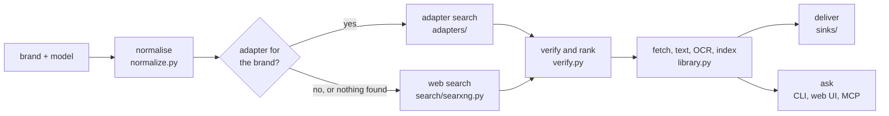
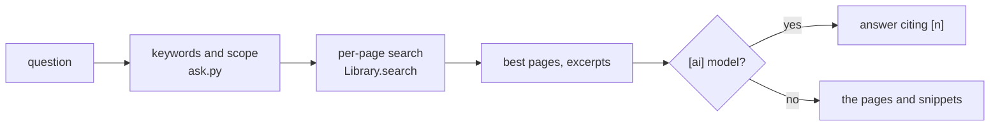
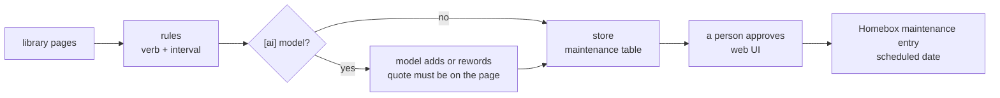

# How Manual Beagle works

Every lookup runs the same pipeline. Each step has a plain, rules-only version; AI plugins (the optional vision
model that reads rating plate photos, the model that writes Ask's answers, and the model that adds to
maintenance suggestions) may add to a step but never replace it.



In words: a lookup starts from a brand and a model as a person typed them. **Normalise** turns the brand into the
name an adapter answers to and the model into a list of variants, most specific first. If an adapter knows the
brand, it **searches the maker's own site**. If no adapter knows the brand, or the adapters found no document,
the **web search** (a SearXNG the user runs) looks instead. Both kinds of result go to **verify and rank**, which
scores each candidate with fixed rules. Up to there nothing is downloaded: `find` stops at a ranked list. When
the user asks for the manual itself, the **library** downloads the PDF, extracts each page's text (OCR only for
pages without text), checks that the text names the model, and indexes every page for full-text search. From
the library a manual is **delivered** to an inventory or a folder (sinks), or **asked** about, page by page,
from the CLI, the web UI, or an AI assistant over MCP.

**Ask your manuals** (`ask.py`) answers a question from the library: retrieval, then optional generation. It
searches the per-page index for the question's words (less the little ones) joined by `OR`, so bm25 puts the
pages that hold the most and rarest of them first, narrowed to a brand, model or document when one is picked or
the question names one the library has. The best four pages (at most three from one document), each cut to the
1,500 characters around the words it matched, go to the `[ai]` model with the question, numbered `[1]` to `[4]`;
the model is told to use only those pages, to cite each one it uses, and to say `NOT IN MANUALS` when they don't
answer it, which becomes "The manuals don't say." With no model, the answer is the pages themselves.



A lookup can also start from a photo. **Read the rating plate** (`nameplate.py`) runs Tesseract on a photo of the
appliance's rating plate and suggests a brand and model by the plate's labels and the adapters' brand names; the
person confirms them, and the lookup starts as if they had typed them. An optional vision model (`vision.py`)
can add its own suggestion when asked.

From the library, **maintenance suggestions** (`maintenance.py`) read each manual for tasks with an interval
("clean the filter every 2 weeks"), with the page and a quote, matched to the inventory's items. A person approves
each one in the web UI before it becomes a scheduled maintenance entry in Homebox; suggestions and decisions are
kept in the library's database so nothing is suggested twice.



## The modules

| Module | What it does |
|---|---|
| `models.py` | The data: `Query`, `Candidate` (a document that might be the right one), `DocKind`, `FindResult`. |
| `normalize.py` | Brand aliases ("Honeywell Home" → Resideo) and model variants, most specific first: `LRFXS2503S/00` → `LRFXS2503S`. Vehicles split the year off. |
| `http.py` | `PoliteClient`: one request at a time per site, a delay between them, a named User-Agent, a size cap, refuses private addresses (except the user's own configured services), stops at bot walls (`Blocked`), and records or replays responses (`Cassette`). |
| `adapters/` | The registry (`__init__.py`), the schema and base class (`base.py`), YAML search steps (`yaml_adapter.py`), the adapter files (`defs/*.yaml`) and Python escape hatches (`py/*.py`). See [adapters.md](adapters.md). |
| `search/` | Web-search plugins. SearXNG through its JSON API is the default. Upstream engines suspend a SearXNG that asks too often, so searches are at least 4 s apart, a lookup sends at most two (stopping at the first that finds a PDF naming the model), and an answer where every engine is suspended raises `SearchUnavailable` rather than looking like "nothing found". |
| `pipeline.py` | `find()`: normalise, run the brand's adapters, add the maker's support page as a link, run web search when no adapter found a document (or always, with `--search`), then rank. |
| `verify.py` | The rules-only score: the maker's own domain (+40), an adapter's result (+10), the model in the title or URL (+30, or +20 for a variant), the document kind, a PDF, the language. A URL whose path names another language (`/us/es/`, -15) or country (`/hk_en/`, -8) ranks lower, and so does a maker's staging or test server by its host name (`support.dev1.lutron.com`, -50). Known manual mirrors are link-only. After download, `check_pdf_text` checks that the PDF's own text names the model (+40), including family placeholders such as `WM5700H*A`. |
| `library.py` | Downloads to a content-addressed folder (`<sha256>.pdf`, so a manual shared by several items is stored once), extracts text per page with pypdfium2, runs OCRmyPDF on pages with no text when it's installed, and indexes every page in SQLite FTS5. Also keeps rating plate photos (`photos/<sha256>.jpg`, the `photos` table) with the brand, model and serial a person confirmed. |
| `nameplate.py` | Reads a rating plate photo, rules only: `ocr_image()` runs Tesseract twice (as a block and as sparse text), `read_plate()` finds the model and serial by their labels (`MODEL`, `M/N`, `MOD. NO.`, `S/N`, `SERIAL`, bilingual plates, a value on the next line), skips ratings such as `120V` or `R-410A`, offers unlabelled model-like words as guesses, and matches brands as whole words from `brand_names()` (adapters' brands and aliases, the shared aliases, `COMMON_BRANDS`). `image_type()` checks JPEG or PNG by content; `strip_metadata()` drops Exif, XMP, IPTC and PNG text chunks without re-encoding. |
| `vision.py` | Optional vision models that read a plate photo when asked, on top of `nameplate.py`: `Ollama` (a model you run, default `gemma3`) and `Anthropic` (Claude through the Messages API, default `claude-opus-5-5`), chosen by the `[ai]` table, both through `PoliteClient`. `parse_answer()` takes the JSON object out of a model's reply. |
| `ask.py` | Ask your manuals: `retrieve()` picks the best pages for a question (`keywords()`, `named_scope()`, `excerpt()`), `ask()` gives them to the text model and parses its citations (`cite()`). `Ollama` and `Anthropic` text models, chosen by the same `[ai]` table as `vision.py` (`make_model()`); `model_client()` is their `PoliteClient`. |
| `sinks/` | Homebox (source and sink), the plain folder, `seed` for filling Homebox from a list, and Paperless-ngx (`paperless.py`): file each library manual with brand and model tags, after checking its checksum, and remember what was sent (`Ledger`, the `paperless` table). |
| `sources/` | Where lists of things come from besides an inventory: Home Assistant (`homeassistant.py`), read only over its WebSocket API. `plan_import()` decides, for each device, new, already in Homebox, or skipped and why; `add_to_homebox()` writes what a person confirmed. |
| `newitem.py` | Add to Homebox from a rating-plate scan: `preview()` reads Homebox only (a suggested name from the brand, `product_kind()` and the model; the locations; `matches()`, items with the same maker and model number by `same_item()`), and `add()` writes what the person confirmed, a step at a time: the item (or an existing one), its serial (a GET then PUT, since Homebox's create takes none), the plate photo, then the manual through `sync.plan_item` and `sync.attach`. |
| `sync.py` | `sync homebox`: for each item with a maker and model but no manual, upload the PDF if its text names the model (or, for an adapter's own result, names a related model such as a longer SKU, or the adapter sets `family_manuals` because the maker's manuals cover a range), else upload a manual an earlier run put in the library for the same brand and model whose text names it, else attach a link. A link must be http(s) and the maker's own (an adapter's result or a URL on its domains) unless `--allow-search-links`; titles go in as plain text. `--dry-run` writes nothing to Homebox; `--metrics FILE` writes the outcome as a Prometheus textfile (`write_metrics()`), for a nightly run. |
| `maintenance.py` | Maintenance suggestions read from manuals. `rules_for_page()` finds a maintenance verb with an interval (a week to ten years) in a sentence, a bullet under a part's name, under an interval heading ("EVERY MONTH"), in a frequency table or a schedule row, and keeps the page and a quote. With `[ai]`, `ai_for_page()` asks the model about pages with an interval and keeps its answer only when the quote is on the page and the interval is one the page states; it may reword or add, never remove. `match_items()` ties a document to inventory items by brand alias and model. `Store` keeps suggestions and decisions in the library's `maintenance` table (one per item, task and interval, so nothing is suggested twice); `file_in_homebox()` adds an approved one to Homebox as a scheduled maintenance entry. Only the web UI's approve button calls it. |
| `batch.py` | `batch FILE`: the best manual for every row of a YAML or CSV list of brand and model, for people with no inventory app, with a JSON report. `--fetch` downloads each one into the library with `sync`'s rule (a PDF whose text names the model, else the maker's link) and prints coverage by brand. |
| `mcp_server.py` | The MCP server over stdio, with read tools (including `ask_manuals` and `maintenance_suggestions`). Write tools only with `--allow-write`. |
| `web/` | The web UI (`serve --web`): `app.py`, a Starlette app whose JSON API under `/api` calls `find`, `Library`, `ask`, `batch.look_up`, `sync.plan_item`/`attach`, `nameplate.read_plate` and `vision`; `jobs.py`, which runs batch and sync in a background thread, one at a time; `integrations.py`, the Home Assistant and Paperless-ngx endpoints and `PaperlessAuto`; and `static/`, one page of plain HTML, CSS and JavaScript, with a web app manifest, icons and a service worker so a phone can install it over HTTPS. Listens on 127.0.0.1 and answers only loopback Host names; changes must be same-origin JSON (a nameplate photo is the one image body); any other address, or `--public-url` behind a TLS proxy, needs a token. See [web.md](web.md). |
| `testing.py`, `scoreboard.py` | The adapter test harness (`run_case()`, `CaseResult.as_dict()` for `adapters test --json`) and the generated `docs/brands.md`; `scoreboard.build(live=...)` adds the nightly run's Live column and `breakage()` writes its report (`adapters report`). |
| `config.py` | One TOML file; secrets come from environment variables or files it names. `build()` layers the Settings page's changes and the environment over it. |
| `settings.py` | What the web UI's Settings page may change (`SETTINGS`), each value's check, and `settings.json`, where those changes are kept beside the library. |

## The main types

All paths are under `src/manualbeagle/`.

| Type | Where | What it is |
|---|---|---|
| `Query` | `models.py` | One lookup: `brand`, `model`, optional `year` and preferred `kind`, and what normalising adds: `canonical_brand` and `variants`. |
| `Candidate` | `models.py` | A document that might be the right one: `url`, `title`, `kind`, `language`, `source` (`adapter:<id>`, `search:<engine>` or `page:<id>`), `page_url` (a page a person can open), `link_only` (never download it), and after ranking `score` and `reasons`. `key()` identifies it for de-duplicating. Tracking parameters (`utm_*`, click IDs such as Bing's `msockid`) are stripped from `url` and `page_url` when it is made, so a link attached to Homebox carries none. |
| `DocKind` | `models.py` | The kinds of document: `owners_manual`, `install_guide`, `quick_start`, `parts_list`, `spec_sheet`, `service_manual`, `warranty`, `maintenance_guide`, `navigation_manual`, `energy_guide`, `other`. |
| `FindResult`, `AdapterReport` | `models.py` | What `pipeline.find()` returns: the normalised query, ranked candidates, one report per adapter run (found how many, blocked, or failed with what), and whether web search ran or failed. |
| `AdapterSpec` | `adapters/base.py` | An adapter's YAML file as a pydantic model: brand, aliases, domains, status, search steps (`SearchStep`, `FieldSpec`), kinds, options and test cases (`TestCase`, `Expect`). [adapters.md](adapters.md) documents every field. |
| `Adapter` | `adapters/base.py` | The base class. `find(query, ctx)` returns candidates; helpers `variants()`, `kind_for()` and `candidate()`; `trim_fixture()` keeps recorded responses small. A YAML-only adapter is a `YamlAdapter` (`adapters/yaml_adapter.py`); a Python adapter subclasses `Adapter` in `adapters/py/`. |
| `Context` | `adapters/base.py` | What an adapter gets for one lookup: `http` (the `PoliteClient`) and `note()` for a log line. |
| `Registry` | `adapters/__init__.py` | Loads every `defs/*.yaml` (plus the user's `adapter_dirs`), builds each adapter, and finds the adapters for a brand by name or alias. |
| `PoliteClient`, `Response`, `Cassette` | `http.py` | All network access. Errors: `FetchError`, and its subclasses `Blocked` (a bot wall, CAPTCHA or robots.txt said no), `UnsafeURL` (not http(s), or a private address) and `CassetteMiss` (a replayed request that wasn't recorded). |
| `SearchEngine`, `Hit` | `search/__init__.py` | The web-search plugin interface: `search(query, http, limit)` returns hits. `make_engine(kind, url=...)` builds one from the config; `SearXNG` in `search/searxng.py` is the only engine so far. |
| `Library`, `Document` | `library.py` | The local library: `fetch()` downloads, extracts, OCRs and indexes one candidate; `ocr_missing()` OCRs documents indexed before OCR was installed; `search()`, `read_pages()` and `documents()` read it back. `add_photo()`, `photos()`, `photo()`, `label_photo()` and `delete_photo()` keep rating plate photos. |
| `Reading`, `Suggestion` | `nameplate.py` | What was read from a rating plate: suggestions for the brand, model and serial, best first, each with its `value`, `why`, `source` (`ocr` or a vision model's name) and `sure` (false for a guess), and the OCR text. |
| `Vision`, `VisionError` | `vision.py` | A vision model: `read(image, media_type)` returns suggestions. `make_vision(AIConfig, http)` builds the one the config names, or None. |
| `Answer`, `Source`, `Model`, `AskError` | `ask.py` | What `ask()` returns: the `status` (`answered`, `not_found`, `pages_only`, `model_error`, `no_pages`), the `answer` citing pages as `[n]`, the `sources` (each page given to the model, numbered, with its snippet and whether it was `cited`), the words searched for and the scope; `headline` says the status as a glyph and words. A `Model` is a text model: `complete(system, user)` returns its reply. |
| `Homebox`, `Item` | `sinks/homebox.py` | A Homebox server as a source of items and a sink for manuals (files and links). The folder sink is the function `export()` in `sinks/folder.py`. |
| `Paperless`, `Filed`, `Ledger` | `sinks/paperless.py` | A Paperless-ngx server as a sink: `find_file()` (by checksum), `tag()`, `document_type()`, `upload()`, `task()`. `Filed` is what happened to one manual (`filed`, `exists`, `queued`, `failed`); `Ledger` keeps that per library document. `sweep()` files everything not sent yet. |
| `HomeAssistant`, `Device`, `Offer` | `sources/homeassistant.py` | A Home Assistant as a read-only source of devices (`devices()`, `status()`). An `Offer` is what an import would do with one `Device`: `new`, `have` or `skip`, the brand and model as they'd go into Homebox, the location, and the other devices of the same model. |
| `Plan` | `sync.py` | What `sync` (and `batch --fetch`) decided for one item: `upload`, `link`, `skip` or `none`, and why. |
| `Job`, `Jobs` | `web/jobs.py` | A web UI background job (batch, sync, attach or paperless): its rows so far, its state and summary; `Jobs` runs one at a time. |
| `Config` | `config.py` | The settings below, loaded from one TOML file by `load()`; `read_secret()` reads an API key from an environment variable or a file. |

How they connect: the CLI (`cli.py`), the web UI (`web/app.py`) or the MCP server (`mcp_server.py`) loads a `Config`, builds a `Registry`
and a search engine, opens a `PoliteClient` with `Config.client()`, and calls `pipeline.find(Query, ...)`. `find`
normalises the query, gives each of the brand's adapters a `Context` wrapping that client, collects their
`Candidate`s, adds web-search hits when needed, and ranks them all with `verify.rank()`. The caller prints the
`FindResult`, or hands a `Candidate` to `Library.fetch()`, which downloads through the same client and scores the
PDF's text with `verify.check_pdf_text()`. `sync.plan_item()` combines the two for one inventory item, and
`sync()` then writes the result to `Homebox` with `sync.attach()`. `batch.look_up()` is one row of a list
without downloading, and `batch.row_item()` turns a row into an `Item` for `plan_item`; the CLI and the web UI
both use them.

### Plugins

- **Search engines** subclass `SearchEngine` (a `name` and a `search()` method that returns `Hit`s, fetching only
  through the `PoliteClient` it's given) and are added to `make_engine()` in `search/__init__.py`.
- **Sinks** are where manuals go. Homebox is a class with the API calls it needs (`items()`, `attach_file()`,
  `attach_link()`), driven by `sync.py`; the folder sink is one function over the library; Paperless-ngx is a
  class (`find_file()`, `tag()`, `upload()`) driven by `file_document()` and `sweep()`. A new one (Grocy, say)
  follows them: a module in `sinks/`, a `[name]` table in the config whose class subclasses `TokenSource` (so its
  key is read through `read_secret()` and bound to its address), and the commands that drive it. There is no
  formal sink base class yet; open an issue to agree on one before writing another inventory.
- **Sources** are where lists of things come from besides an inventory: Home Assistant's devices
  (`sources/homeassistant.py`). A source only reads, and gives `Device`-like records (a name, a maker, a model,
  an area) that `plan_import()` turns into offers for Homebox; writing happens only after a person confirms.
- **Adapters** are plugins too: see [adapters.md](adapters.md). Users can add their own YAML adapters, without
  changing the package, by listing folders in `adapter_dirs`; an adapter there with a built-in's id replaces it.
- **AI plugins** only add to a rules-only step, never replace it, and are off unless the `[ai]` table turns one
  on. The first is the vision model that reads rating plates (`vision.py`): a new provider subclasses `Vision`
  (a `provider` name, a default model in `DEFAULT_MODELS`, and `_ask()` sending one photo through the
  `PoliteClient` it's given), and is added to `PROVIDERS`. Ask's text models (`ask.py`) work the same way: a
  subclass of `Model` with `complete(system, user)`, added to `ask.PROVIDERS`. A provider should be in both, so
  one `[ai]` table serves both features. Presets, defaults and docs name only non-Chinese models.

## Configuration

`%APPDATA%\manualbeagle\config.toml` on Windows, `~/.config/manualbeagle/config.toml` elsewhere (or
`MANUALBEAGLE_CONFIG`, or `--config FILE` on the command line). Everything has a default, and a missing file
means all defaults.

```toml
delay = 1.5                      # seconds between requests to one site
respect_robots = false           # robots.txt is for crawlers; turn on to obey it anyway
# home = "/path/to/manualbeagle-data"   # where the library lives (default below)
# adapter_dirs = ["/path/to/my-adapters"]   # extra folders of YAML adapters

[search]
engine = "searxng"               # or "none"
url = "http://localhost:8080"    # SearXNG with `search.formats: [html, json]` in its settings.yml

[homebox]
url = "http://homebox.local:7745"
token_env = "HOMEBOX_TOKEN"      # an API key from Homebox's profile page
token_file = ""                  # or a file holding it

[home_assistant]                 # optional: a source of devices (integrations/homeassistant.md)
url = ""                         # such as http://homeassistant.local:8123
token_env = "HA_TOKEN"           # a long-lived token of a user that can't change anything

[paperless]                      # optional: file manuals in Paperless-ngx (integrations/paperless.md)
url = ""                         # such as http://paperless.local:8000
token_env = "PAPERLESS_TOKEN"    # an API token from Paperless's profile page
auto = false                     # file every new manual by itself
document_type = "Manual"
tags = ["manual"]                # besides the brand and model tags

[ai]                             # optional: reads rating plates, and writes Ask's answers (docs/web.md)
provider = "none"                # or "ollama" (your own) or "anthropic" (Claude)
model = ""                       # default: gemma3 for ollama, claude-opus-5-5 for anthropic
url = ""                         # ollama's address (default http://localhost:11434)
api_key_env = ""                 # anthropic: the variable holding the API key (default ANTHROPIC_API_KEY)
```

The library and its database live in `%LOCALAPPDATA%\manualbeagle` or `~/.local/share/manualbeagle` (or
`MANUALBEAGLE_HOME`, or `home` in the file): PDFs under `library/`, the index in `manualbeagle.sqlite`.

The web UI's Settings page saves its changes in `settings.json` in that same folder, and they win over the
file. It can change the settings in `settings.SETTINGS` (the delay, robots.txt, web search, the Homebox address
and links, Home Assistant's and Paperless-ngx's addresses, Paperless's `auto` and document type, and the AI
model), never `home`, `adapter_dirs`, or where a key is read from (`token_env`, `token_file`, `token_command`,
`api_key_env`), so the page can't run a program, read a secret or move the library. Homebox's, Home
Assistant's and Paperless's keys are also bound to the address set beside them in the file or the environment
(`TokenSource.bind_key`, called by `build()`): an address the page alone changed gets no key, so whoever can change
settings can't send a key to their own server.

Four environment variables override both (`config.ENV_OVERRIDES`): `MANUALBEAGLE_SEARXNG` (the SearXNG URL),
`MANUALBEAGLE_HOMEBOX_URL`, `MANUALBEAGLE_HA_URL` and `MANUALBEAGLE_PAPERLESS_URL`. Secrets are never read from the file itself, only from the environment variable or
file it names. The only private addresses the client will reach are the origins of `[search] url` and
`[homebox] url`. With `provider = "ollama"`, the `[ai]` model's own client may also reach `[ai] url`; the clients
for lookups and downloads, whose URLs come from web sites, may not. The Homebox, Home Assistant and Paperless
clients talk only to their own configured address, with their own HTTP (or WebSocket) client rather than the
`PoliteClient`, since nothing they reach comes from a web site.

Integrations have their own pages: [Homebox](integrations/homebox.md), [Home Assistant](integrations/homeassistant.md),
[Paperless-ngx](integrations/paperless.md), [a plain folder](integrations/folder.md) and
[MCP for AI assistants](integrations/mcp.md). [privacy.md](privacy.md) lists what is sent where.

## Rules the code keeps

- Fetches happen on the user's machine, for that user. Nothing is hosted or shared.
- No CAPTCHA, bot wall or login is ever got around. A blocked site falls back to web search.
- No AI is required for anything.
- Colour is never the only signal in output, the CLI's or the web UI's: every status has a glyph and a word.
- The web UI serves the library only to this computer unless the user starts it on another address, and then
  only with a token.
- A rating plate photo is only read for suggestions; nothing is looked up until the person confirms the brand and
  model. Its metadata is stripped before it's kept.
- A maintenance suggestion reaches Homebox only when a person clicks **Add to Homebox** for it. A model's
  suggestion is kept only when its quote is on the page.
